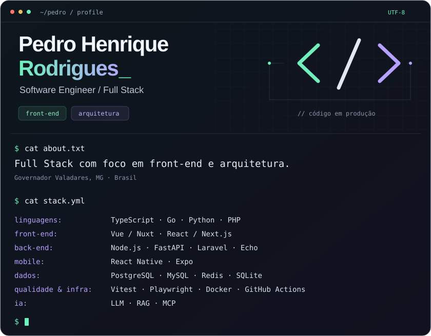

  <picture>
    <source media="(max-width: 900px)" srcset="./assets/profile-window-compact.svg" />
    
  </picture>

  
  
  
  

  <a href="https://gist.github.com/PedroHRFerreira/9a9c99f7bd9c15c192132440554dfe1e"><strong>Apresentação profissional completa →</strong></a> 
  Minha trajetória, experiência e projetos em um só lugar.

## Notas técnicas

- [**Como evito baixa duplicada no estoque**](https://gist.github.com/PedroHRFerreira/daebd82e1e1eaa891e4c9540a81b3691) — ERP EMPI: implementação em Go e GORM, teste automatizado e limites da validação.
- [**Buscar antes de ler: contexto no Rods SDK**](https://gist.github.com/PedroHRFerreira/ddff43f350f6e1a8b113faaba27f408f) — busca com SQLite FTS5, leitura por trecho e testes de indexação e escopo.
- [**Revisar antes de gravar: importações no ARCA Tracker**](https://gist.github.com/PedroHRFerreira/23c5d45f069759b07b96fd1e637b7afc) — prévia, confirmação e revalidação em transação, com testes de duplicidade e rollback.
